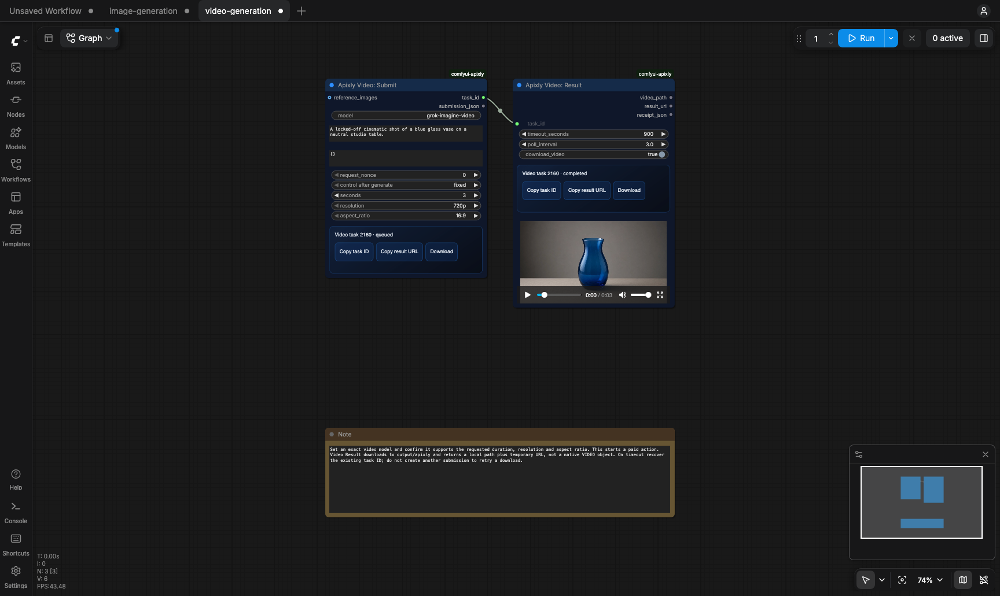
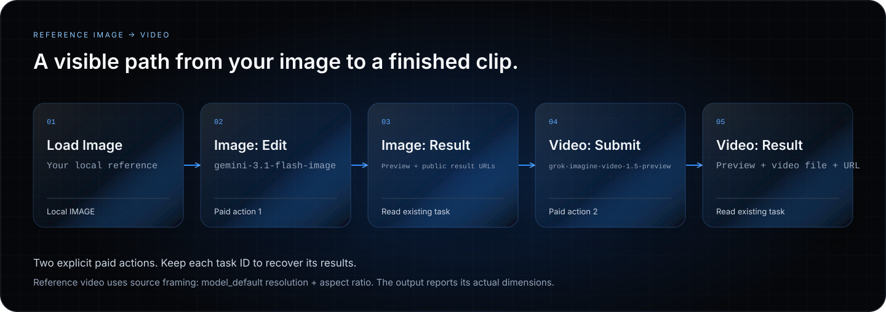
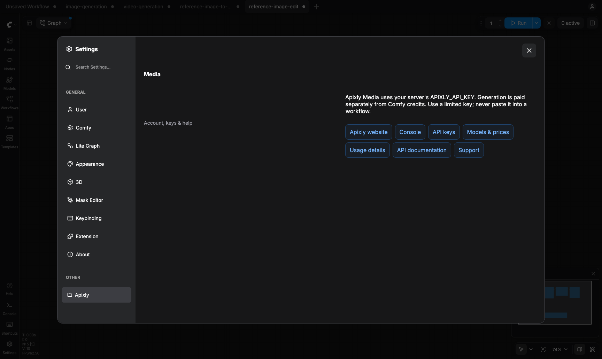

<picture>
  <source media="(max-width: 640px)" srcset="assets/hero-mobile.svg">
  
</picture>

# Apixly Media for ComfyUI

Generate images, edit references and create videos through [apixly.ai](https://apixly.ai).
Connect your own Apixly account, choose an owned Key and discover its current models.
Shape lighting, viewpoint and camera instructions for free, then explicitly submit
an exact model. Preview the result and pass images, URLs or video files to the next step.

**15 nodes · 12 starter workflows · [中文说明](README.zh-CN.md)**

<p>
  <a href="#install"><strong>Install the nodes →</strong></a> ·
  <a href="#2-connect-your-account"><strong>Connect your account →</strong></a> ·
  <a href="https://platform.apixly.ai/keys">Manage API Keys</a> ·
  <a href="https://platform.apixly.ai/models">Models &amp; prices</a> ·
  <a href="https://registry.comfy.org/publishers/apixly/nodes/comfyui-apixly">Comfy Registry</a>
</p>

**MIT licensed · Python 3.10+ · No local GPU required for API generation**

- **Free creative controls:** orbit diagrams, lighting presets and camera/lens instructions compose a prompt without an API call.
- **More original Studixly tools:** expression grid and face preview, lossless image-grid slicing, AI enhancement instructions and nine character-sheet plans. Five new nodes execute offline for free.
- **Your account and models:** authorize in your browser, choose the default Studixly Key or another owned Key, then open a live model picker.
- **Images and reference edits:** use a dedicated editing node and pass every image in a reference batch.
- **Text and reference video:** use explicit models and keep the resulting file or temporary URL.
- **Task recovery:** copy the task ID and retrieve an existing result without generating again.

The plugin is free. Generation requires your own Apixly account or server API key, access
to the chosen model, and sufficient API balance. API charges are separate from
Comfy credits and subscriptions. This package is maintained by Apixly and is not
a Comfy Partner Node. Selected 1K image generation costs **US$0.02 per image** as
checked on October 23, 2026; see [current model prices](https://platform.apixly.ai/models)
for your model and settings.

## See it in ComfyUI



A real completed run in the official ComfyUI host. Submit and Result are separate
nodes, so you can keep the task ID, stop local waiting and recover the same task.
The result panel includes **Copy task ID**, **Copy result URL** and **Download**.

## A real reference-to-video result

<p align="center">
  <a href="assets/examples/edited-vase.png"></a>
  <a href="assets/examples/reference-video.mp4"></a>
</p>

**Left:** `gemini-3.1-flash-image` edited the [original reference](assets/examples/reference-vase.png).
**Right:** a frame from the [actual 3-second MP4](assets/examples/reference-video.mp4)
made with `grok-imagine-video-1.5-preview`. These are saved API results, without
retouching. The example video uses source framing and decodes to 960 × 960;
results and dimensions depend on the model and input.

## Choose a starting workflow

Open **Templates → comfyui-apixly** or drag a linked JSON file onto the canvas.

| Start with | What it does | Qualified starting model |
| --- | --- | --- |
| [Free creative prompt](example_workflows/creative-prompt.json) | Lighting + viewpoint + camera/lens → final prompt; no Key or model request | No model required |
| [Expression + Compose V2](example_workflows/expression-prompt-v2.json) | Original 5×5 expression grid + the three existing controls; all Off initially | No model required |
| [Lossless image grid](example_workflows/image-grid-split.json) | Local image → separate pixel-exact tiles + coordinates → preview | No model required |
| [AI enhancement instruction](example_workflows/image-enhancement-prompt.json) | Free preservation prompt and model parameters; paid edit starts muted | No model required for preview |
| [Character sheet plan](example_workflows/character-sheet-plan.json) | Nine templates; select one shot explicitly; no automatic generation | No model required |
| [Creative → image](example_workflows/creative-image-generation.json) | Free prompt preview → explicitly enabled image generation | `grok-imagine-image` |
| [Creative → reference edit](example_workflows/creative-reference-edit.json) | Free edit prompt → your local reference → explicitly enabled edit | `gemini-3.1-flash-image` |
| [Creative → video](example_workflows/creative-video-generation.json) | Free prompt preview → explicitly enabled 3-second text video | `grok-imagine-video` |
| [Image generation](example_workflows/image-generation.json) | Prompt → image preview | `grok-imagine-image` |
| [Reference edit](example_workflows/reference-image-edit.json) | Local image → reference edit → image preview | `gemini-3.1-flash-image` |
| [Video generation](example_workflows/video-generation.json) | Prompt → 3-second, 720p, 16:9 clip | `grok-imagine-video` |
| [Reference image → video](example_workflows/reference-image-to-video.json) | Local image → visible image edit → URL → video | Gemini image edit, then Grok 1.5 reference video |

<picture>
  <source media="(max-width: 640px)" srcset="assets/workflow-mobile.svg">
  
</picture>

The reference-to-video template contains **two explicit paid actions**. Use
`model_default` for resolution and aspect ratio on its Grok reference-video step;
this omits those API fields and uses source framing. The diagram is explanatory;
[view the actual configured canvas](assets/screenshots/reference-to-video-workflow.png).
These exact presets passed bounded live checks. They do not establish support
or output quality for every model or parameter combination.

The three **Creative → media** templates start with their media group muted
(**Mode: Never**) and a fixed nonce. Running their free section only compiles a
prompt. Review the final prompt, exact model and price, choose your reference if
needed, then explicitly unmute the media group and queue a paid action.

## Install

### 1. Add the nodes to ComfyUI

From your ComfyUI directory, with its Python environment activated:

```sh
git clone https://github.com/apixly-ai/comfyui-apixly.git custom_nodes/comfyui-apixly
python -m pip install -r custom_nodes/comfyui-apixly/requirements.txt
```

The package is also listed on [Comfy Registry](https://registry.comfy.org/publishers/apixly/nodes/comfyui-apixly).

### 2. Connect your account

Start or restart ComfyUI, open the **Apixly sidebar**, and choose **Connect / reconnect**.
The click prepares a new tab and opens the official [apixly.ai](https://apixly.ai)
approval page when the short-lived link is ready. Check the short code. If your
browser blocks the new tab, use **Open authorization page** or **Copy authorization
link**. These actions reuse the same pending connection; they do not create another
request. If clipboard access fails, select the displayed read-only link and copy
it manually. Cancelled, expired and completed links disappear from the sidebar.
Sign in
normally, review the requesting plugin and approve **your own Studixly Key
(default)** or another active Key from your account. Return to ComfyUI to finish.
Your website password and login JWT never enter the plugin.

The sidebar shows the selected Key's name and mask. Change it with the owned-Key
dropdown, refresh its metadata, switch modes explicitly, or disconnect this
connection. You can also revoke a lost connection from
[website connection settings](https://apixly.ai/integrations).
For a limited project budget, create a capped [Key](https://platform.apixly.ai/keys)
first and select it during approval or in the sidebar.

This is one **server operator account**, just like a server environment key.
A Comfy browser client ID is not a separate authenticated user. Use separate
ComfyUI instances for different users or billing accounts. Connect from the local
ComfyUI UI; account changes require same-origin checks and a panel CSRF token.

### 3. Alternatively, use a server environment key

Choose **Use server APIXLY_API_KEY** in the sidebar if you prefer a Key supplied
by your server launcher. No key entry is exposed to the browser. On macOS/Linux,
read the key without putting it into shell history:

```sh
read -s APIXLY_API_KEY
export APIXLY_API_KEY
python main.py
```

<details>
<summary>Windows PowerShell</summary>

```powershell
$secret = Read-Host "Apixly API key" -AsSecureString
$env:APIXLY_API_KEY = [System.Net.NetworkCredential]::new("", $secret).Password
python main.py
```

</details>

Restart ComfyUI after installation. Search for **Apixly** in Add Node, or open one
of the twelve templates above. With ComfyUI Desktop or a managed service, set the
variable in the actual server launcher; another terminal's environment will not
reach an already-running server. Never put a key in a prompt, node, workflow,
screenshot or public issue.

No runtime package installation is performed. The HTTP client uses the small
`httpx` dependency; image nodes use ComfyUI's existing PyTorch, NumPy and Pillow.

<details>
<summary>Account links inside ComfyUI</summary>



This capture shows the earlier Settings link panel. The new account controls
live in the **Apixly sidebar**; service links remain in **Settings → Apixly → Media**:
[website](https://apixly.ai), [console](https://platform.apixly.ai),
[API keys](https://platform.apixly.ai/keys), [models & prices](https://platform.apixly.ai/models),
[usage details](https://platform.apixly.ai/usage/logs), [API docs](https://apixly.ai/docs)
and [support](mailto:support@apixly.ai).
[View the narrow-screen settings capture](assets/screenshots/account-settings-mobile.png).

</details>

## Free creative controls

Add **Viewpoint**, **Lighting** and **Camera & Lens**, then connect their typed
outputs to **Compose Prompt**. Each tool starts **Off**; when all are off, Compose
keeps your base prompt exactly. Turning controls on changes instructions only.
The final prompt is visible and can be copied before any generation.

- **Viewpoint:** choose a fixed direction preset or drag the orbit marker. Positive
  elevation means above the subject. The diagram and first drag use the effective
  preset angle; switching its viewing grid does not alter the instructions.
- **Lighting:** use a preset or adjust direction, brightness, a deliberate color,
  environment and optional free text. Turning it off preserves settings for later.
- **Camera & Lens:** choose camera/lens descriptions, framing and an optional
  explicit focal-length instruction. These are creative hints, not measured optics.
- **Compose Prompt:** use `generate` for a new scene or `edit` to ask the model to
  preserve the reference subject while changing the requested qualities.

The controls compose ordinary AI instructions. They do not add undocumented
provider fields or promise an exact 3D camera transform, physically simulated
lighting or identical subject preservation. The selected model determines the
result. They work without a Key, and preview/reset/copy never queue a generation.
Connect `final_prompt` to a Submit/Edit prompt only when you intend to generate.

## Expression, image tools and character plans

The five new nodes execute without credentials, network requests, a submission
journal or model calls. Prompt tools start **Off**; the character planner starts
with **Choose one shot**. Running a free node does not queue a paid node.

- **Expression:** the original Studixly 5×5 grid and parameterized face show
  energy vertically and affinity horizontally. Warm is left, aloof is right.
  Target a named person if needed. Center and Off add no prompt fragment.
- **Compose V2:** combines viewpoint → lighting → expression → lens. It accepts
  existing angle/lighting/camera outputs plus `APIXLY_EMOTION_V2`. Original V1
  nodes and contracts stay unchanged; when expression is Off or neutral, V2
  preserves the V1 final prompt byte for byte. After changing older controls,
  click **Refresh preview** or execute the free node to confirm the final text.
- **Grid Split:** Off passes the entire original IMAGE batch through as one
  output item. On slices RGB/RGBA source pixels without resizing, padding or
  dropping edges. The IMAGE list is ordered by input batch, row, then column;
  `coordinates_json` records every tile. Equal splits use floor boundaries;
  normalized custom cuts use positive half-up pixel rounding. Duplicate or
  empty cuts and more than 144 total tiles are rejected. The diagram uses cut
  proportions; execute for actual pixel coordinates. **Downstream nodes run
  once per list item.** Connect Preview/Save unless you intend multiple paid
  requests.
- **AI Enhancement Prompt:** copies the original preservation instruction and
  offers known model parameter mappings. Connect its exact `model`, `prompt`
  and `parameters_json`, plus your reference image, to Image Edit. A connected
  reference supplies actual dimensions; otherwise set width/height. This is
  **AI redraw enhancement**, which can alter details and text. Its settings do
  not prove pixel preservation, real super-resolution or guaranteed improvement.
- **Character Sheet Plan:** nine original templates include key visual,
  turnaround, head closeups, expressions, poses, costume, color/material,
  proportions and the Seedance pack. The pack is **three independent front,
  three-quarter and side shots**. `plan_json` previews the plan; only one
  explicitly chosen `selected_prompt` and `selected_aspect` are output. The
  selected shot follows its identity if sheets are reordered; removing it
  clears selection and requires a new choice. The native `shot_index` also
  allows deliberate selection (`-1` means none). User text is inserted literally,
  including dollar signs and template-like braces. There is no hidden batch
  inference or promise of generated character consistency.

The enhancement starter keeps Image Edit, Image Result and Preview in **Mode:
Never**, with nonce `0` fixed. Choose a source, review the free output, exact
model and current price, then explicitly unmute and press Run once for a paid
edit. Keep the original nonce/task for recovery. The expression, grid and
character starters contain no paid submission node.

## Live model pickers

Image and video Submit/Edit nodes provide a picker for the **current selected
Key**, plus an exact/custom model path that preserves your chosen ID. Opening a
picker lazily reads the selected-key catalog. Options have a ten-minute cache,
stale-while-revalidate behavior, one shared refresh per identity and a manual
**Refresh models** action. Failure preserves same-identity saved options with a
stale/error indicator; changing accounts or Keys discards old in-flight results.
Refresh does not switch models or generate anything.

One limited-Key check on October 23, 2026 listed **14 image and 11 video options**.
These are observations for that Key, not permanent package counts or a promise
that every listed model/mode is qualified. Exact permissions and video
capabilities come from the live service.

## Nodes

| Node | Behavior | Outputs |
| --- | --- | --- |
| Apixly Prompt: Viewpoint | Composes optional subject-relative angle instructions | typed angle, instruction text |
| Apixly Prompt: Lighting | Composes optional lighting and environment instructions | typed lighting, instruction text |
| Apixly Prompt: Camera & Lens | Composes optional camera/lens/framing instructions | typed camera, instruction text |
| Apixly Prompt: Compose | Combines your base prompt and enabled tools; never generates | final prompt, controls JSON |
| Apixly Prompt: Expression | Original 5×5 expression guidance with optional target person | `APIXLY_EMOTION_V2`, instruction text |
| Apixly Prompt: Compose V2 | Old three controls plus expression; nonbreaking V2 composition | final prompt, versioned controls JSON |
| Apixly Image: Grid Split | Offline lossless slicing; Off preserves the whole input batch | IMAGE list, coordinates JSON |
| Apixly Prompt: AI Enhancement | Free preservation instruction and known model parameter mapping | prompt, parameters JSON, aspect ratio, exact model |
| Apixly Prompt: Character Sheet Plan | Plan JSON plus one deliberately selected shot | plan JSON, selected prompt, selected aspect |
| Apixly Image: Submit | Starts one asynchronous text-to-image job | `task_id`, `submission_json` |
| Apixly Image: Edit | Requires reference images and explicitly suggests the qualified Gemini editing model | `task_id`, `submission_json` |
| Apixly Image: Result | Waits for an existing image task and decodes every result | `IMAGE`, result URL JSON, receipt JSON |
| Apixly Video: Submit | Starts a video task, with public reference URLs when the model supports them | `task_id`, `submission_json` |
| Apixly Task: Status | Performs one status GET for an existing task | status, result URL, receipt JSON |
| Apixly Video: Result | Waits for an existing video task and optionally downloads it | local video path, result URL, receipt JSON |

Drag a JSON file from [`example_workflows/`](example_workflows/) onto the canvas.
Set an exact model ID that your Apixly API key can use. Image generation suggests
`grok-imagine-image`; reference editing explicitly suggests
`gemini-3.1-flash-image`. The latter preserved the source vase and changed the
background in the initial live smoke test; this is a bounded sample, not a quality
guarantee. Grok reference editing is not qualified by that result. Video suggests
`grok-imagine-video`. Available models and permissions depend on your API key group.
Check your selected-key model catalog; `GET https://apixly.ai/v1/models/list` lists IDs and model types
and `GET https://apixly.ai/v1/video/config` exposes current video capabilities.
The plugin does not rename a model, select a fallback, or change requested fields.

### Image generation and editing

Connect Image Submit → Image Result → Preview Image or Save Image. Typical
`parameters_json` for a model supporting these options is:

```json
{"size":"1024x1024","quality":"high","n":1}
```

Use **Apixly Image: Edit** and connect Load Image to `reference_images` to edit an existing image. An IMAGE batch
is sent as separate PNG reference files. The selected model must support the
operation and fields. References are never silently discarded or duplicated.
Mixed-size result batches are reported instead of being resized without permission.

Temporary image results currently expire after about ten minutes. Download them
promptly or connect Image Result → Save Image. The plugin's temporary preview
files may be cleared when ComfyUI restarts; keep a saved local copy.

**Masked inpainting is unavailable in this release.** The public nodes do not
expose a MASK input and reject explicit masks before a paid request. Low-level
REST transport tests remain for future qualification. Ordinary reference-image
editing and multiple references are separate, supported workflows.

### Video generation

Connect Video Submit → Video Result. Model-specific options are flat JSON, for
example, only when the selected model supports them:

```json
{"seconds":5,"resolution":"720p","aspect_ratio":"16:9"}
```

Use `reference_image_urls` for public HTTPS reference images. It accepts Image:
Result's `result_urls_json` output, a JSON array of URLs, or one URL per line.
The `reference-image-to-video` template visibly connects Load Image → Gemini Edit
→ Image Result URLs → Grok image-to-video → Video Result. It contains two paid
actions, and does not silently upload a local file to a third-party host.

A free live
capability check rejects references for known text-only models before submission.
Choose an explicit image-to-video model, such as `grok-imagine-video-1.5-preview`,
for references; the plugin never drops references or switches models. Unknown
models remain subject to the gateway's validation. That Grok route currently
requires public URLs: local IMAGE/data-URL input is rejected before submission
with instructions for the visible image-result URL workflow. Other routes may
support local IMAGE tensors as inline PNGs, but this release does not claim
compatibility with every route. Choose one reference source, not both.

For `grok-imagine-video-1.5-preview` reference video, choose **model_default** for
both resolution and aspect ratio. This explicitly omits those API fields and
uses source framing. Explicit geometry for that route is not qualified and is
rejected before a paid request, including geometry in advanced JSON. Inspect
the decoded result for its actual dimensions; a square source can produce a
square video. The qualified text-video preset remains 3 seconds, 720p, 16:9.

Reference URLs are read once through bounded HTTPS GETs without an API key to
verify the image and hash its content. The original URLs are sent unchanged to
Apixly. Refreshing a signed URL for the same bytes therefore reuses the same
nonce/action; a source-download failure never starts a paid video. Do not put
private account credentials in these URLs. Reference limits, task modes, output
duration, resolution, and billing are model dependent; inspect current video
capabilities before choosing them. This initial version supports `/v1/videos`
generation, not the separate `/v1/videos/edits` video-edit endpoint.

Duration, resolution, and aspect ratio have dedicated video controls; conflicting
values in advanced JSON are rejected before submission. The default is a 3-second
720p, 16:9 generation. Verify prices before running it.

The result node downloads a recognizable MP4/MOV/WebM body into
`ComfyUI/output/apixly/` by default. Its `video_path` is a file path string, **not**
a ComfyUI `VIDEO` object; use a video-loader node that accepts a path if a later
workflow requires a native video object. The returned `result_url` is suitable
for URL-based workflow steps and is temporary. Save completed media promptly.
The current client download limit is 256 MiB per video and 32 MiB per image.

Results show native image/video previews. The node's result panel can copy the
task ID or temporary result URL and download a saved file. Image previews use
ComfyUI's temporary directory. Video progress uses the server-reported percentage
when available; a running image task does not invent a completion estimate.

## Paid actions, new runs, and recovery

`request_nonce` identifies an explicit generation action. **A new nonce allows a
new paid job even with the same model and prompt.** ComfyUI's after-generation
control can increment or randomize it for a new queue run. Select `fixed` while
diagnosing a submission. Changing the request contents also starts a new action.

A private local SQLite journal binds a key/account digest, request digest, and
nonce to the accepted task ID. Re-executing the same action returns that ID.
Public reference-image identity uses its content hash rather than the temporary
URL signature, so URL refreshes do not create another paid generation.
Only digests, task IDs/statuses, timestamps, and submission states are stored;
keys, prompts, reference bytes, and raw API responses are not stored there.
Account-mode request identity uses the account, selected Key and selection revision;
replacing a connection token alone does not turn the same paid action into a new one.
Its default location is `ComfyUI/user/apixly/submissions.sqlite3` (the actual
ComfyUI user-directory setting is respected). `APIXLY_STATE_DIR` may select a
different server-owned directory. It must be writable by the ComfyUI user.

The client never automatically retries a paid POST. If a submission times out,
loses its response, or receives an ambiguous server error, the nonce is guarded
as **unknown**. Check your existing Apixly tasks/account activity before selecting
a new nonce. A journal is a local recovery guard, not a gateway idempotency key:
deleting it, moving machines, changing the key, or selecting another nonce does
not cancel an accepted task and can create another charge.

For normal waiting, recover by copying the known task ID into **Image Result**,
**Video Result**, or **Task Status**. These nodes only make reads. Temporary
status errors are retried within the configured deadline. Waiting timeout,
failed download, or expired URL never triggers a new generation. Refresh an
existing task to obtain a fresh signed URL while its media remains available.
If the media itself has expired, report that state instead of generating again.
An image Result node can fail after Submit succeeded: **do not increment the
submit nonce just to retry downloading**.
Interrupted media downloads get at most three safe GET attempts; partial bodies
are discarded and are never delivered as completed files.

Use trusted workflows and protect access to the ComfyUI server. Account connections
and environment credentials apply to that server process: another person who can
execute its nodes may spend the selected Key's balance. The plugin has no key widget or secret
output, but prompts and returned signed result URLs can still appear in normal
ComfyUI workflow/output metadata. See [PRIVACY.md](PRIVACY.md).

Account connection state is separate from the submission journal. It contains a
revocable connection token and short-lived pending proofs in a private JSON file:
`~/.local/share/apixly/comfyui/connection.json` by default on macOS/Linux, or under
`LOCALAPPDATA` on Windows. `APIXLY_CONNECTION_DIR` can select a server-owned
location. The directory is mode `0700` and the file `0600` on POSIX; it is never
stored in ComfyUI's browser-readable userdata or a workflow. Disconnect revokes
the connection, rather than deleting your underlying API Key.

## Development and release checks

```sh
python -m pytest -q
node --test tests/*.test.mjs
python -m compileall -q apixly_media
python -m pip wheel --no-build-isolation --no-deps . --wheel-dir /absolute/path/to/artifacts
```

Tests run offline with a fake HTTP transport, temporary journals, and real image
tensor conversion. Live model qualification and billing checks are separate and
must use a limited test key. Before publishing, verify PublisherId `apixly` is
owned by the publishing account, the public repository/icon/support URLs work,
and image generation/editing plus video terminal output have been verified
against the exact models advertised in release notes. Do not advertise untested
models or claim a completed live generation from offline tests.

Publishing follows the [Comfy Registry guide](https://docs.comfy.org/registry/publishing).
Run `comfy node publish` from the standalone release checkout using its Registry
publishing key, not an Apixly inference key. Registry packages must contain the
root `__init__.py`, `apixly_media/`, license, docs, assets, and example workflows.
The wheel is for client packaging validation; ComfyUI loads the Registry/repository
custom-node package. All versions must meet the [Registry quality and security
standards](https://docs.comfy.org/registry/standards).

Support: [support@apixly.ai](mailto:support@apixly.ai).
When reporting a problem, include plugin version, exact model, task/request ID,
status, and sanitized error text. Never send your API key or private media in a
public issue.
