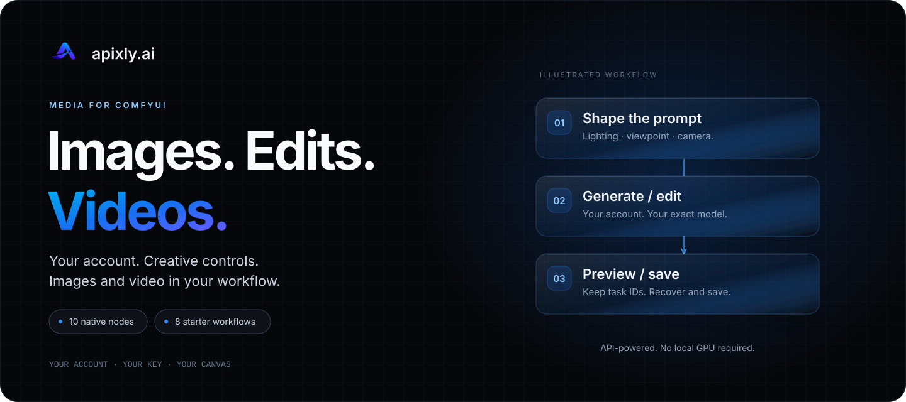
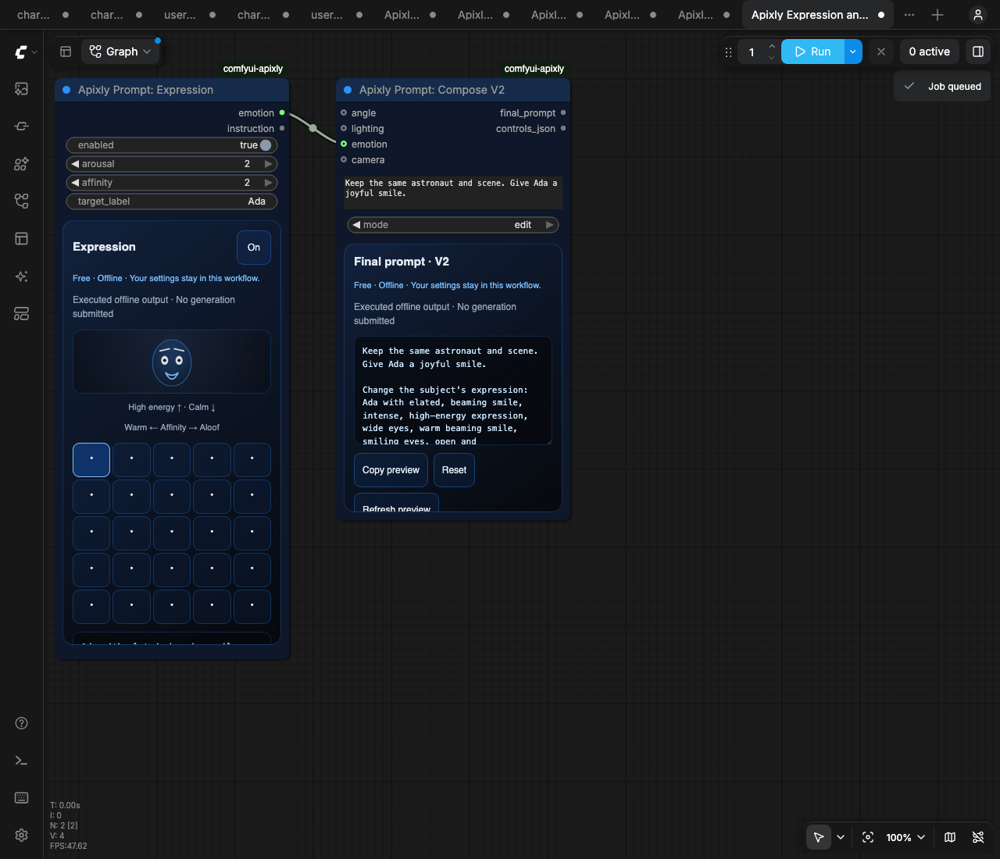
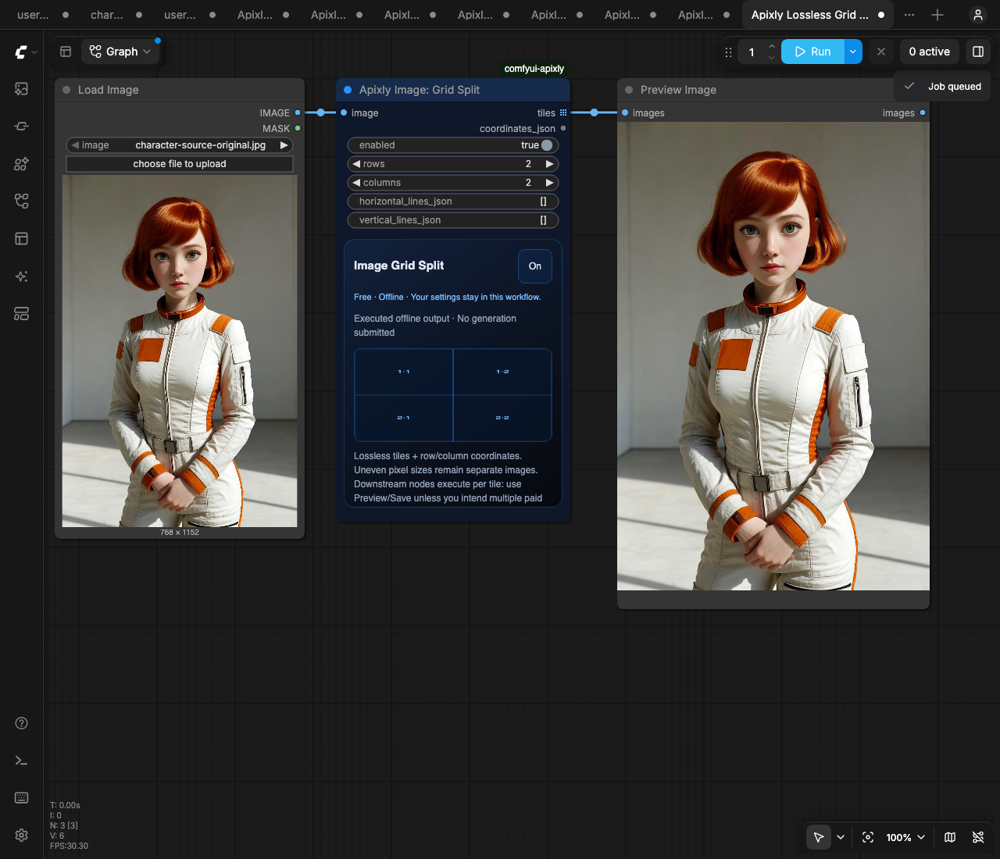
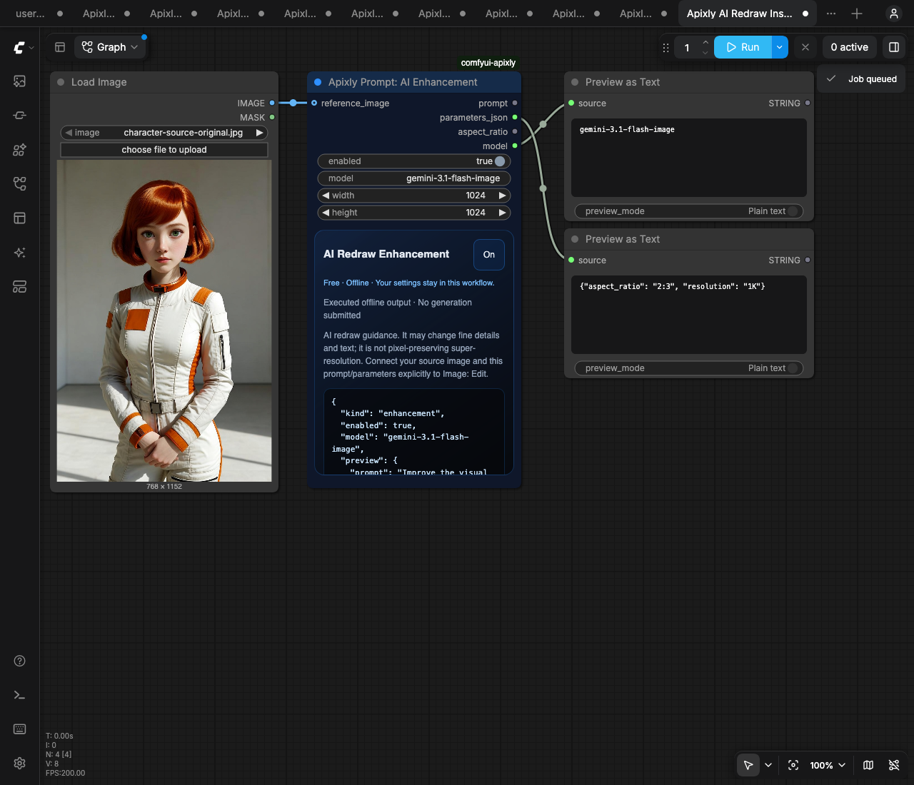
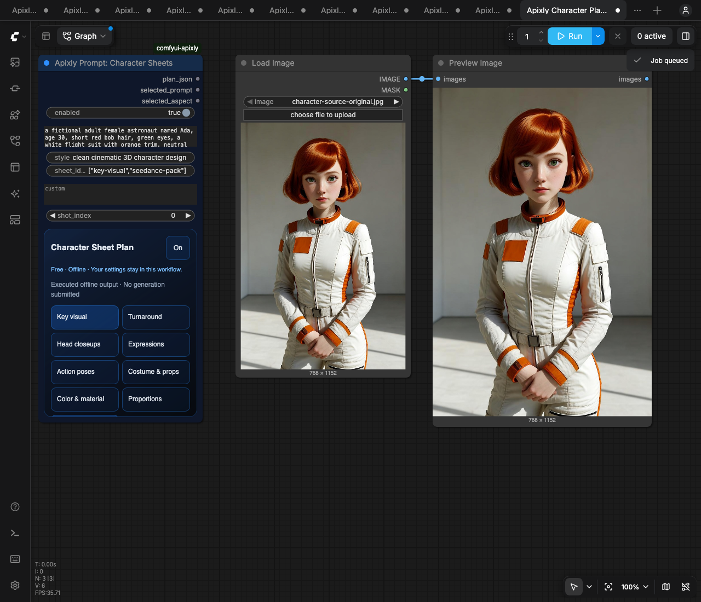

<picture>
  <source media="(max-width: 640px)" srcset="assets/hero-mobile.svg">
  
</picture>

# Apixly AI API for ComfyUI：生图、参考图编辑与视频生成

**15 个节点 · 12 个工作流 · 9 个免费工具节点 · [English](README.md)**

在 ComfyUI 中使用 [apixly.ai](https://apixly.ai) 生图、参考图编辑和生视频。连接自己的 Apixly 账号，选择默认 Studixly Key 或自己已有的 Key，懒加载该 Key 当前可用的图片/视频模型。账号、额度、API Key 与用量由 [platform.apixly.ai](https://platform.apixly.ai) 统一管理。

> **在 ComfyUI 工作流中使用低成本图片、视频 API。**
> 连接 Apixly 账号，选择模型并保存结果。打光、角度、表情和镜头控件可免费整理提示词；准备好后再明确提交付费请求。
>
> **官网：** [apixly.ai](https://apixly.ai) · **API 控制台：** [platform.apixly.ai](https://platform.apixly.ai) · [模型与价格](https://platform.apixly.ai/models) · [获取 API Key](https://platform.apixly.ai/keys) · [API 文档](https://apixly.ai/docs)

插件免费；模型生成按你的 Apixly 账号余额计费。模型目录代表可发现的权限，不代表每个模型/参数都已完成质量验收。当前价格以[模型页面](https://platform.apixly.ai/models)为准。

## 关于 Apixly AI API

[Apixly](https://apixly.ai) 为开发者提供文本、图片和视频模型 API，平台包含 GPT、Gemini、Claude 文本模型。本插件将图片、参考图编辑与视频工作流接入 ComfyUI；账号、API Key、模型权限和用量在 [Apixly API 控制台](https://platform.apixly.ai)管理。

2026-10-25 核对的两个限定价格示例：

- `gemini-3.1-flash-image` 的 1K 档：**每张 US$0.02**。
- 指定 GPT 文本模型 `gpt-6.1-sol` 的标准输入、输出 token 档：**[OpenAI 官方报价](https://developers.openai.com/api/docs/models/gpt-6.1-sol)的 1 折**。

具体价格随型号、档位和 Key 而定。GPT 示例属于文本 API，不代表所有 GPT、Gemini、Claude、图片或视频模型均为 1 折；提交前请查看[当前模型与价格](https://platform.apixly.ai/models)。

从[创建 API Key](https://platform.apixly.ai/keys)、[API 文档](https://apixly.ai/docs)或下方[ComfyUI 安装与连接指南](#安装和连接)开始。本仓库由 Apixly 维护，插件源码使用 MIT 许可证。

## 实机界面与真实样例

  
  

  
  

截图只有免费工具与宿主预览节点，点击可看大图。切图实际输出四张独立图片，宿主 Preview 将它们拼成马赛克式预览；角色图片是单独载入的已保存样例，免费计划节点不会自动生成。小屏若被宿主小地图遮住，可使用 **Hide Minimap**。

  
  
  

左图由 `grok-imagine-image` 生成；中图由表情 → Compose V2 → `gemini-3.1-flash-image` 编辑；右图使用增强指令 → 同一 Gemini 模型。两次编辑都引用左侧已保存原图。这里保留原 API 文件字节和提供方元数据，没有后期修图。请求画幅为 2:3，实际尺寸依次是 768×1152、848×1264、843×1264。原计划虽写全身，第一张实际没有拍到脚；AI 重绘也可能改变细节，不能据此承诺像素不变的超分或一定更好。

## 常见问题

### Apixly 的 ComfyUI 节点能做什么？

可以文生图、用一张或多张参考图编辑，以及通过支持相应输入的模型生成文本视频或参考视频。12 个模板还覆盖提示词编排、表情、切图、增强指令和单镜头角色计划。免费计划工具只准备输入，模型生成需要明确执行付费 Submit 节点。

### 需要本地显卡或 Comfy credits 吗？

API 生图、生视频通过 Apixly 执行，不需要本地生成显卡。插件与离线工具免费，模型请求使用 Apixly 余额；价格和权限由所选模型与 Key 决定。Comfy credits、ChatGPT 或 Claude 订阅不能充当 Apixly API Key。

### 可以绑定已有账号、使用自己的 Key 吗？

可以。在 Apixly 侧栏连接账号，通过正常网站授权，选择自己的默认 Studixly Key 或其他有效 Key；也可以明确切换到服务端配置的手动 Key。具体步骤见[安装和连接](#安装和连接)，Key 在[控制台](https://platform.apixly.ai/keys)管理。

### 图片、视频模型如何更新？

模型选择器按当前 Key 的权限读取目录，缓存十分钟，可手动刷新；也支持明确输入精确模型 ID。刷新不会静默改掉已有模型。目录可发现不代表所有型号、参数组合或输出质量都已通过本插件验收。

### 已有任务能恢复结果而不再生成吗？

使用原任务 ID 接入 Image Result、Video Result 或 Task Status。这些节点只读取已有任务，不会提交新的生成。请及时保存结果，图片临时媒体约保留十分钟；媒体本身过期后，换 URL 不能恢复它。遇到不确定的提交结果，先查原任务，不要通过改 nonce 盲目重试。

### 凭据放在哪里？Registry 发布是否代表审核通过？

凭据属于 ComfyUI 服务端操作者，不写入节点或工作流。能在该服务执行节点的人可能使用所选 Key 的余额；不同账号请用隔离实例，完整边界见 [PRIVACY.md](PRIVACY.md)。Registry 安全审核和节点提取是分别记录的流程；公开页面、ZIP 可下载或 GitHub 发版都不能证明审核通过。见[审核说明](docs/REGISTRY_REVIEW.md)与[官方当前状态](https://api.comfy.org/nodes/comfyui-apixly/versions?include_status_reason=true)。

## 安装和连接

从 [Comfy Registry](https://registry.comfy.org/publishers/apixly/nodes/comfyui-apixly) 安装，或把仓库克隆到 `ComfyUI/custom_nodes/comfyui-apixly`，在实际 ComfyUI Python 环境安装 `requirements.txt` 后重启。详细命令见[英文安装说明](README.md#install)。

打开 **Apixly 侧栏 → Connect**。点击时会先准备一个浏览器标签，再跳转到 Apixly 的正常登录/授权页；登录后审核并确认 Key。若未自动打开，使用 **Open authorization page** 跳转，或 **Copy authorization link** 手动打开。同一个有效授权流程会继续等待，不需要再次创建验证码。在同一授权链接打开的确认页，可填写或核对插件显示的短认证码；该链接包含本次授权流程的地址。

凭据保留在 ComfyUI 服务端，不写进节点或工作流。也支持服务端环境变量 `APIXLY_API_KEY`，两种模式需显式切换。共享服务实例的用户可能使用同一个已绑定 Key；不同账号应使用隔离实例。完整边界见 [PRIVACY.md](PRIVACY.md)。

## 这次迁入的网页工具

五个新节点覆盖四项功能，均可离线执行，不读取 Key、不访问网络、不调用模型。加上原有四个免费提示词节点，共九个免费节点。提示词工具默认 Off；角色计划默认未选择镜头。

四个新模板以 1:1 初始视图聚焦主工具，节点默认宽 300px；详情可竖向滚动，其他节点保留在画布上供平移查看。原版 Templates 会自动缩放整张图，因此仅对带专属标记且初始视图未被改存的模板，在加载后恢复一次初始视图。保存的自定义视图、后续缩放与手动节点尺寸会保留；等待恢复时遇到点击或滚轮操作会取消恢复。旧工作流不受影响。

| 新节点 | 功能和输出 |
| --- | --- |
| Apixly Prompt: Expression | 复用原 5×5 表情网格和参数化人脸；输出 `APIXLY_EMOTION_V2` 设置及指令 |
| Apixly Prompt: Compose V2 | 角度→打光→表情→镜头；输出最终提示词和带版本的设置 JSON |
| Apixly Image: Grid Split | 原图像素切块；输出 IMAGE 列表与完整行列/坐标 JSON |
| Apixly Prompt: AI Enhancement | 免费保真增强指令；输出提示词、参数 JSON、画幅和精确模型 ID |
| Apixly Prompt: Character Sheet Plan | 九类角色设定计划；输出计划 JSON、明确选中的单镜提示词/画幅 |

**表情**：上方更激动、下方更平静，左侧更亲近、右侧更疏离；可填写目标人物。中心格或 Off 不注入表情指令。它是提示词引导，实际表情由模型决定。

**Compose V2**：接受原角度、打光、相机节点的 typed 输出，加上新的 `APIXLY_EMOTION_V2`。原 V1 编译契约和节点保持不变；表情关闭或中性时，V2 最终提示词与 V1 逐字节相同。修改旧工具后，点击 **Refresh preview** 或执行免费 Compose V2，确认当前连接输入。

**网格切分**：Off 将整个原 IMAGE batch 作为一个列表项通传；On 才按“输入 batch→行→列”切分。支持 RGB/RGBA、多张输入及不等尺寸切块，不插值、不填充、不丢边缘。均分采用 floor 边界，自定义 0～1 切线采用正数半入取整；重复/像素重合/空块或总数超过 144 会明确报错。预览按切线比例绘制，执行后读取真实像素坐标。IMAGE 列表会让下游按块执行，通常应接 Preview/Save；若连接付费节点，可能产生多笔请求。

**AI 增强**：复用网页原保真指令和已知模型参数映射。源图连接后自动取实际尺寸，未连接则使用宽高设置；将同源的 model、prompt、parameters_json 和源图显式接入 Image Edit。它属于 **AI 重绘增强**，可能改变细节或文字，不承诺像素不变、真实超分或一定改善。增强模板的付费节点默认 **Mode: Never**，nonce 固定为 0；审核模型与价格后，显式解除静音并只按 Run 一次。保留原 nonce/任务用于恢复。

**角色计划**：包含定妆、转身、头部、表情、动作、服装、色彩材质、比例和 Seedance 参考包。Seedance 包是正面、四分之三、侧面 **三张独立图的计划**。只有主动选择的一个镜头会输出普通 STRING；不会返回自动映射的提示词列表或暗中批量付费。重排设定类型会保留同一镜头身份；移除该镜头则清空选择，必须重新选。原生 `shot_index` 也可手动选择，`-1` 表示未选择。用户文字中的美元符号及模板样式花括号按字面保留，不递归展开。生成后是否角色一致仍须看实际模型结果。

## 12 个入门工作流

在 Templates → comfyui-apixly 打开，或拖入 JSON：

| 工作流 | 用途 |
| --- | --- |
| [原免费创作提示词](example_workflows/creative-prompt.json) | 原角度、打光、相机、Compose |
| [表情与 Compose V2](example_workflows/expression-prompt-v2.json) | 四组创作工具；默认全 Off |
| [原图网格切分](example_workflows/image-grid-split.json) | 选择本地图后离线切分/预览 |
| [AI 增强指令](example_workflows/image-enhancement-prompt.json) | 免费预览；付费编辑默认 Never |
| [角色设定计划](example_workflows/character-sheet-plan.json) | 明确选择一个镜头；无付费节点 |
| [创作→生图](example_workflows/creative-image-generation.json) | 免费编排后显式启用生成 |
| [创作→参考编辑](example_workflows/creative-reference-edit.json) | 免费编排后显式启用参考编辑 |
| [创作→视频](example_workflows/creative-video-generation.json) | 免费编排后显式启用视频 |
| [基础生图](example_workflows/image-generation.json) | 异步任务与图片预览 |
| [基础参考编辑](example_workflows/reference-image-edit.json) | 本地参考图→编辑→预览 |
| [基础视频](example_workflows/video-generation.json) | 提交/查询/下载视频 |
| [参考图→视频](example_workflows/reference-image-to-video.json) | 两个明确付费步骤，保留任务恢复 |

另有六个媒体节点：Image Submit、Image Edit、Image Result、Video Submit、Task Status、Video Result。已验证的既有媒体样例、操作与范围见[英文说明](README.md#see-it-in-comfyui)。图片临时结果会过期，应及时 Save Image；任务未知状态应查询同一任务，不能重复提交。普通参考编辑与原生蒙版重绘不同；当前未开放蒙版重绘。

## 开发验证

0.3.1 更新文档、包描述、发现性元数据与请求 User-Agent 中的发布版本标识；节点行为、模板、账号鉴权流程和模型参数沿用已验收的 0.3.0。

0.3.1 再次通过 672 项 Python 与 244 项 JavaScript 检查，并用离线请求头测试及实际构建的 wheel 核对发布元数据。本次文档发布没有新增付费模型请求。

安装测试依赖 `python -m pip install -e '.[test]'`，再执行 `python -m pytest -q` 与 `node --test tests/*.test.mjs`。测试 extra 包含 NumPy，运行环境使用宿主 ComfyUI 已有的 PyTorch/NumPy/Pillow。原网页 381e TypeScript 差分 fixture 保留来源哈希；字面插值修复使用单独回归 fixture，未伪造为旧网页输出。

0.3.0 已通过 **672 项 Python、244 项 JavaScript 检查**，并在原版 ComfyUI frontend 1.57.1 完成 Templates/JSON 载入、桌面和 375px 面板边界与 44px 触点、真实滚轮到达复制/重置、保存自定义画布与节点尺寸的恢复。RGB/RGBA、奇数尺寸和多图切块均对照进入切图节点的像素逐项恢复；三笔独立放行的真实图片请求完成，原 API 文件及原生下载均已解码保存。实际模型边界见上方样例；headless 浏览器不代表已实测触摸或 iOS。支持：[support@apixly.ai](mailto:support@apixly.ai) · [API 文档](https://apixly.ai/docs) · [账号与用量](https://platform.apixly.ai)。
